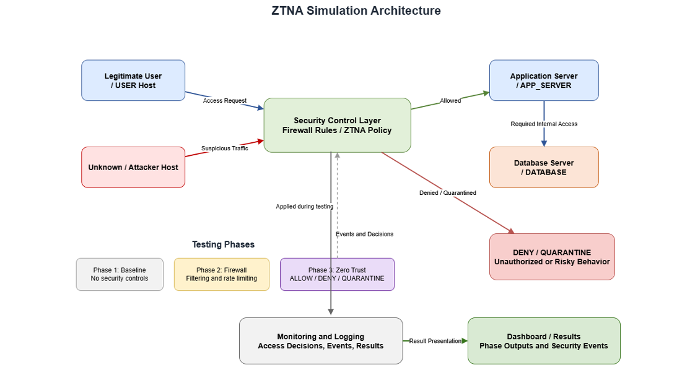
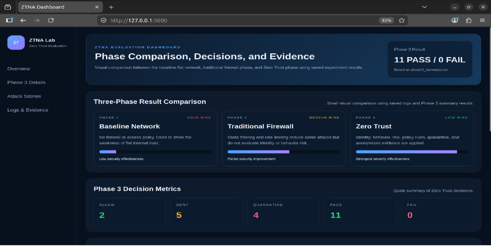

# Design, Implementation, and Experimental Evaluation of a Zero Trust Network Access Defense System

**A three-phase experimental cybersecurity framework integrating context-aware access control, behavioral threat detection, risk-based policy enforcement, automated threat containment, and privacy-aware security analysis.**

## 1. Project Overview

This project presents the design, implementation, and experimental evaluation of a Zero Trust Network Access (ZTNA) defense system within a controlled, Mininet-based network environment.

The framework investigates how different security architectures respond to legitimate communication, unauthorized access attempts, network reconnaissance, lateral movement, and SYN flood attacks.

The experimental design consists of three phases:

1. **Phase 1 — Baseline Network:** An unrestricted network without additional security controls.
2. **Phase 2 — Traditional Firewall:** A firewall-based security model applying packet filtering, logging, and rate limiting.
3. **Phase 3 — Zero Trust Architecture:** A context-aware access-control system integrating behavioral detection, cumulative risk scoring, policy decisions, and automated enforcement.

The primary objective is to experimentally evaluate how Zero Trust principles improve access control, restrict unauthorized internal communication, and support threat containment compared with traditional network security approaches.
### System Architecture



*Figure 1. High-level architecture of the three-phase ZTNA simulation, showing the protected resources, security control layer, traffic sources, and monitoring components.*

## 2. Research Objectives

The project aims to:

- Design and implement a controlled network simulation environment.
- Generate legitimate and malicious network traffic.
- Evaluate the security limitations of unrestricted network communication.
- Analyze the effectiveness and limitations of traditional firewall controls.
- Implement context-aware Zero Trust access policies.
- Detect suspicious network behaviors and classify associated risks.
- Enforce ALLOW, DENY, and QUARANTINE decisions.
- Collect and anonymize experimental evidence.
- Compare security outcomes across three network architectures.

## 3. Key Security Features

### Context-Aware Access Control

Access decisions consider predefined source and destination roles, observed behavior, risk classification, and security policies.

### Behavioral Threat Detection

The system evaluates selected suspicious activities, including:

- Port scanning
- Subnet scanning
- SYN flood behavior
- Unauthorized lateral movement attempts

### Risk-Based Decision Engine

A weighted, rule-based risk scoring mechanism classifies suspicious events into LOW, MEDIUM, and HIGH risk levels.

### Automated Policy Enforcement

Security decisions are implemented using Linux networking mechanisms:

- **ALLOW:** Permit communication explicitly authorized by policy.
- **DENY:** Block unauthorized communication.
- **QUARANTINE:** Restrict sources associated with high-risk behavior.

### Least-Privilege Access

The Zero Trust phase limits communication according to predefined network roles and permitted resource relationships.

For example, legitimate USER → APP_SERVER and APP_SERVER → DATABASE communication is permitted, while unauthorized direct database access is denied.

### Privacy-Aware Security Logging

The framework collects experimental logs and supporting evidence, with anonymization mechanisms that replace network identifiers in selected records to reduce unnecessary exposure of sensitive information.

### Security Analytics Dashboard

A Flask-based dashboard presents phase comparisons, access decisions, risk classifications, testing outcomes, attack narratives, and supporting evidence.

## 4. Experimental Methodology

The project uses a controlled, comparative experimental design.

| Phase | Security Architecture | Evaluation Focus |
|---|---|---|
| Phase 1 | Baseline | Network exposure without additional security controls |
| Phase 2 | Traditional Firewall | Traffic filtering, logging, and rate limiting |
| Phase 3 | Zero Trust | Context-aware access decisions, behavioral detection, and automated containment |

Selected scenarios are evaluated across the security phases to investigate differences in access permissions, reconnaissance exposure, lateral communication, and attack mitigation.

### Network Environment

The simulation uses Mininet to create virtual hosts, network links, and services.

The Phase 3 topology includes four principal network roles:

- **USER:** Legitimate user host.
- **UNKNOWN:** Unauthorized or potentially malicious host.
- **APP_SERVER:** Protected application service.
- **DATABASE:** Sensitive internal resource.

These components provide a controlled environment for testing authorized and unauthorized communication.

## 5. Zero Trust Decision Pipeline

The Zero Trust implementation follows a structured access-decision workflow:

**Identity → Behavior → Risk → Policy → Enforcement → Evidence**

1. **Identity:** Determine predefined source and destination network roles.
2. **Behavior:** Evaluate traffic characteristics and identify suspicious events.
3. **Risk:** Calculate cumulative risk scores and classify risk levels.
4. **Policy:** Select ALLOW, DENY, or QUARANTINE according to defined security rules.
5. **Enforcement:** Apply the selected restrictions through Linux network rules.
6. **Evidence:** Record decisions, outcomes, and supporting information for analysis.

This pipeline provides an explainable approach to security policy enforcement within the simulated environment.

## 6. Technologies and Tools

| Technology | Purpose |
|---|---|
| Python 3 | Security logic, testing, and automation |
| Mininet | Virtual network simulation |
| Ubuntu / Linux | Experimental operating environment |
| iptables | Firewall rules and access enforcement |
| Flask | Security analytics dashboard |
| HTML / CSS | Dashboard interface |
| Nmap | Port and subnet scanning tests |
| hping3 | SYN flood traffic generation |
| tcpdump | Packet capture and traffic evidence |
| CSV / Text Logs | Experimental results and analysis |

## 7. Security Analytics Dashboard

The Flask-based dashboard provides a structured view of the experimental evaluation.

Its main capabilities include:

- Three-phase security comparison
- Zero Trust policy decision summaries
- ALLOW / DENY / QUARANTINE metrics
- Expected versus actual test outcomes
- Risk scores and risk classifications
- Attack scenario narratives
- Security logs and supporting evidence
- Privacy-aware result presentation

The dashboard uses experimental result files, including `phase3_summary.csv`, to present access decisions and test outcomes.
### Dashboard Overview



*Figure 2. Security dashboard showing the three-phase comparison and Phase 3 policy validation results: 11 PASS, 0 FAIL, 2 ALLOW, 5 DENY, and 4 QUARANTINE.*

**Note:** The security effectiveness bars are illustrative comparisons, not experimentally calculated effectiveness percentages.

## 8. Experimental Results and Key Findings

The three-phase evaluation demonstrated differences between unrestricted communication, traditional firewall-based protection, and Zero Trust policy enforcement.

### Three-Phase Security Comparison

| Security Scenario | Baseline | Firewall | Zero Trust |
|---|---|---|---|
| Legitimate HTTP access | Allowed | Allowed | Allowed |
| Unauthorized HTTP access | Allowed | Allowed | Denied |
| Port scanning | Successful | Slowed | Quarantined |
| Subnet scanning | Successful | Discovery remained possible | Quarantined |
| Unauthorized lateral movement | Allowed | Allowed | Denied |
| SYN flood | Unrestricted | Rate-limited | Quarantined |

These findings indicate that traditional firewall rules reduced selected attack effects but did not fully prevent unauthorized access or lateral communication in the experimental topology.

In contrast, the Zero Trust phase applied policy-based restrictions and risk-based containment decisions.

### Phase 3 — Policy Validation Results

The Zero Trust implementation was evaluated through 11 predefined policy test scenarios.

| Metric | Recorded Result |
|---|---|
| Total Tests | 11 |
| Passed Tests | 11 |
| Failed Tests | 0 |
| ALLOW Decisions | 2 |
| DENY Decisions | 5 |
| QUARANTINE Decisions | 4 |

**All 11 predefined tests passed, with actual decisions matching the expected policy outcomes.**

These results demonstrate functional correctness for the selected scenarios rather than universal protection against all cyberattacks.

### Key Finding 1 — Legitimate Access Preservation

The system allowed required communication between legitimate users and authorized services.

For example:

- USER → APP_SERVER: ALLOW
- APP_SERVER → DATABASE: ALLOW

### Key Finding 2 — Unauthorized Access Prevention

The system denied communication that violated predefined access policies, including direct access to sensitive internal resources.

Examples include:

- USER → DATABASE: DENY
- UNKNOWN → APP_SERVER: DENY
- UNKNOWN → DATABASE: DENY
- UNKNOWN → USER: DENY

### Key Finding 3 — Trusted User Behavioral Quarantine

One of the most significant experimental observations involved a legitimate user performing suspicious port scanning.

Although the source belonged to a trusted network role, the system identified the risky behavior and returned a QUARANTINE decision.

This result demonstrates the importance of evaluating observed behavior rather than relying exclusively on predefined source trust.

### Key Finding 4 — Lateral Movement Restriction

Unauthorized internal communication succeeded in the baseline and firewall phases under the tested conditions.

The Zero Trust phase restricted the corresponding unauthorized internal access attempts through policy enforcement.

### Key Finding 5 — Privacy-Aware Evidence Collection

The framework generated experimental logs and anonymized records, supporting security analysis while reducing exposure of selected network identifiers.

## 9. Research Contribution

This work contributes a controlled experimental framework for investigating Zero Trust access-control behavior through comparative security evaluation.

Its principal contributions include:

1. **Comparative Architecture Evaluation:** A structured comparison of baseline, firewall, and Zero Trust security models.
2. **Explainable Security Decisions:** Integration of network role identification, behavioral detection, cumulative risk scoring, and policy-based enforcement.
3. **Risk-Based Threat Containment:** Evaluation of automated quarantine responses to selected suspicious activities.
4. **Least-Privilege Network Segmentation:** Restriction of unauthorized internal communication and access to sensitive resources.
5. **Privacy-Aware Experimental Analysis:** Integration of anonymized logs and supporting security evidence.

The project emphasizes practical implementation and architectural evaluation rather than relying exclusively on theoretical analysis.

## 10. Project Structure

```text
ZTNA-Security-Simulation/
├── code/
│   ├── phase1_baseline/
│   ├── phase2_firewall/
│   └── phase3_ztna/
├── dashboard/
│   ├── app.py
│   ├── static/
│   └── templates/
├── logs/
│   ├── anonymized/
│   ├── phase3_summary.csv
│   └── experimental result files
├── README.md
└── .gitignore
```

## 11. Execution Requirements

The project is designed for a Linux environment supporting Mininet and Linux networking tools.

Required components include:

- Python 3
- Mininet
- iptables
- tcpdump
- Nmap
- hping3
- curl
- Flask

Install Flask in the appropriate Python environment:

```bash
python3 -m pip install flask
```

Additional system packages and permissions may be required depending on the Linux distribution and environment.

### Phase 1 — Baseline

```bash
cd code/phase1_baseline
sudo python3 baseline_phase.py
```

### Phase 2 — Traditional Firewall

```bash
cd code/phase2_firewall
sudo python3 run_firewall_phase.py
```

### Phase 3 — Zero Trust

```bash
cd code/phase3_ztna
sudo bash run_phase3.sh
```

### Security Dashboard

From the repository root:

```bash
cd dashboard
python3 app.py
```

Open the local address displayed by Flask in a web browser.

**Note:** The project was developed and tested in a controlled Linux-based simulation. Reproduction on a newly configured environment may require additional dependency and network setup. The published code has not yet been fully revalidated on a fresh installation.

## 12. Scope and Limitations

This project is an academic security prototype, not a production-ready enterprise ZTNA solution.

Important limitations include:

- Experiments were conducted within a small simulated topology.
- Evaluation was limited to selected access and attack scenarios.
- Identity evaluation relies on predefined network role mappings rather than integration with a production identity provider.
- Risk scoring is based on predefined event weights rather than a trained machine learning model.
- The experimental tests do not establish security effectiveness against unknown attacks or large-scale production workloads.
- Broader performance and scalability measurements remain areas for further evaluation.

These limitations define the scope of the conclusions and provide opportunities for future research.

## 13. Future Research Directions

Potential extensions include:

- Integration with authenticated identity providers
- Device posture assessment
- Dynamic and adaptive access policies
- Machine-learning-assisted anomaly detection
- Advanced lateral movement and credential misuse scenarios
- Larger network topologies and more complex security environments
- Automated quantitative security metrics
- Performance evaluation using latency, throughput, and resource utilization
- Expanded reproducibility and comparative benchmarking

These extensions could support further investigation of adaptive and context-aware Zero Trust security architectures.

## 14. Academic Context

This project was developed as an undergraduate graduation research project for the Bachelor of Science in Information Technology and Computing at Arab Open University, Egypt.

**Project Title:** Design, Simulation, and Analysis of a Zero Trust Network Access (ZTNA) Architecture

**Author:** Sahar Effat Mahmoud Ali

**Academic Year:** 2025–2026

The work focuses on the design, implementation, and controlled experimental evaluation of Zero Trust security principles.

**Research Areas:** Cybersecurity, Network Security, Zero Trust Architecture, Policy-Based Access Control, Behavioral Threat Detection, and Security Analytics.

## 15. Ethical and Responsible Use

All security tests were designed for a controlled simulation environment.

The project is intended for academic research, educational experimentation, and authorized cybersecurity analysis.

It should not be used to test networks or systems without explicit permission.
